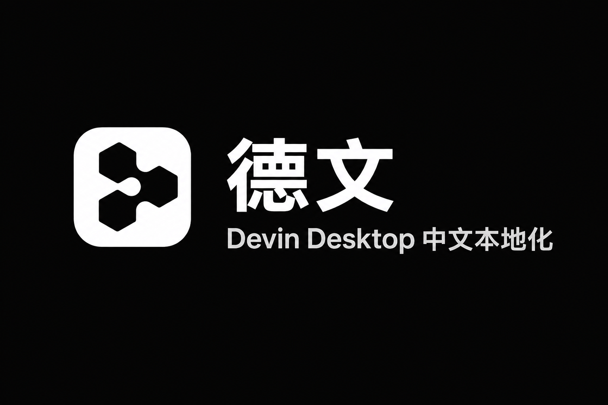
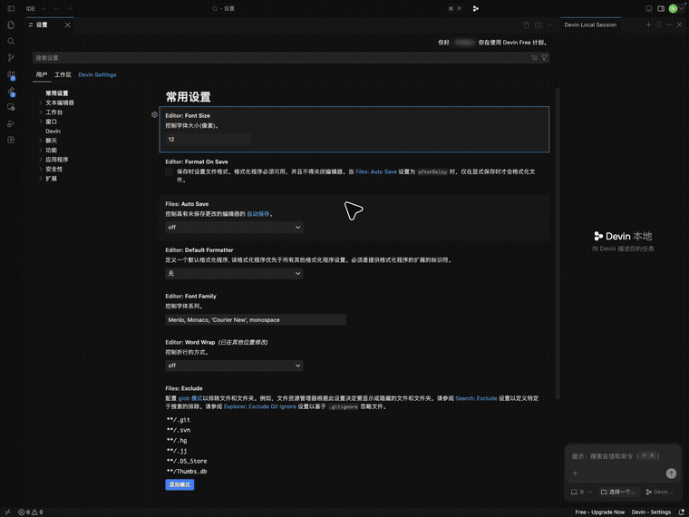
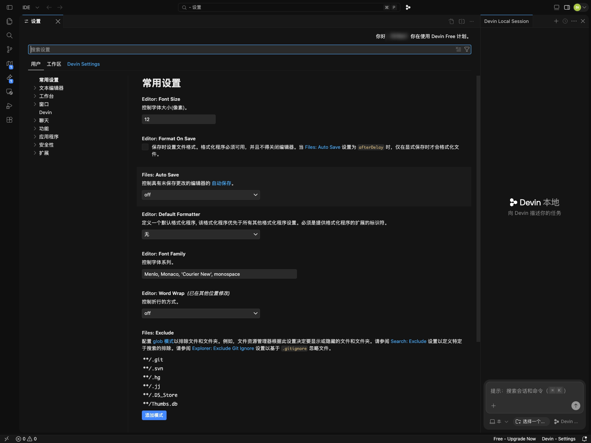
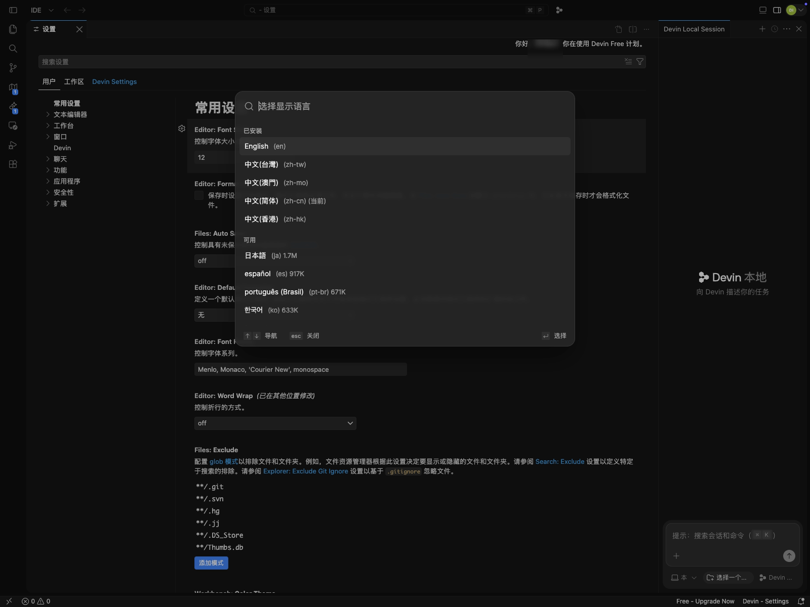
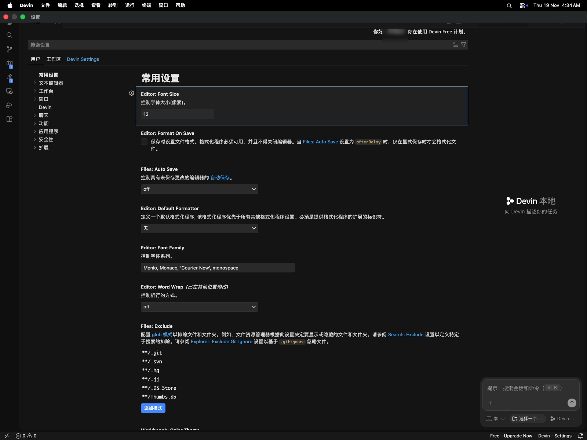
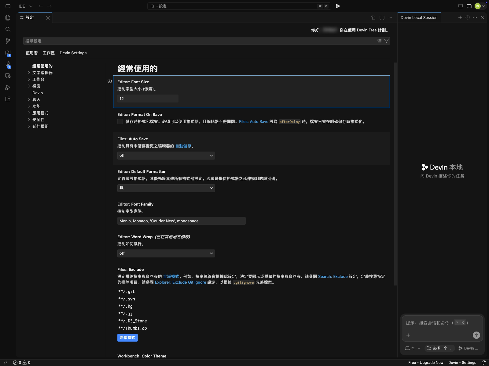
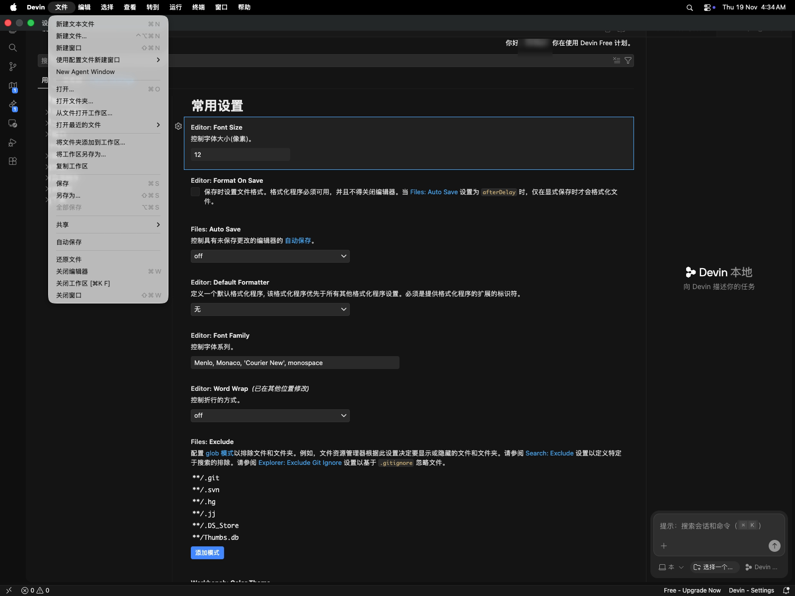
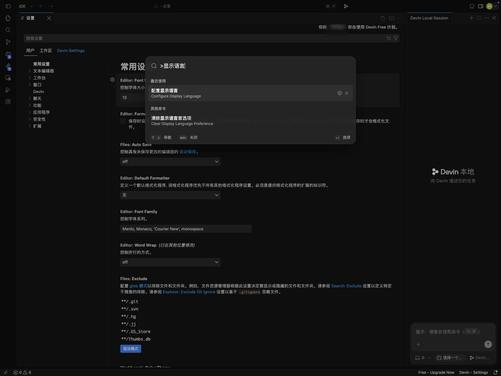
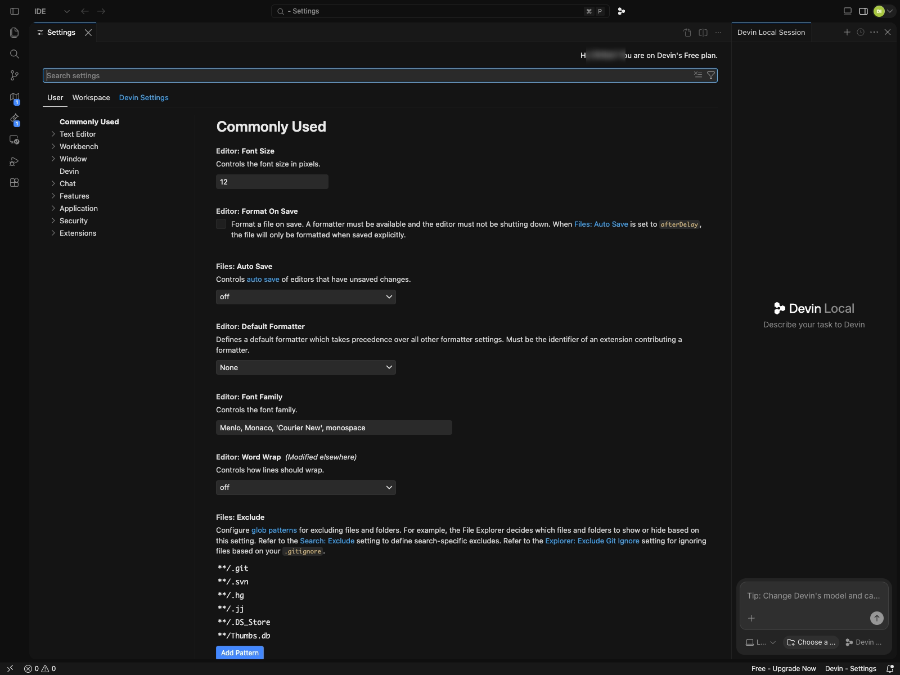
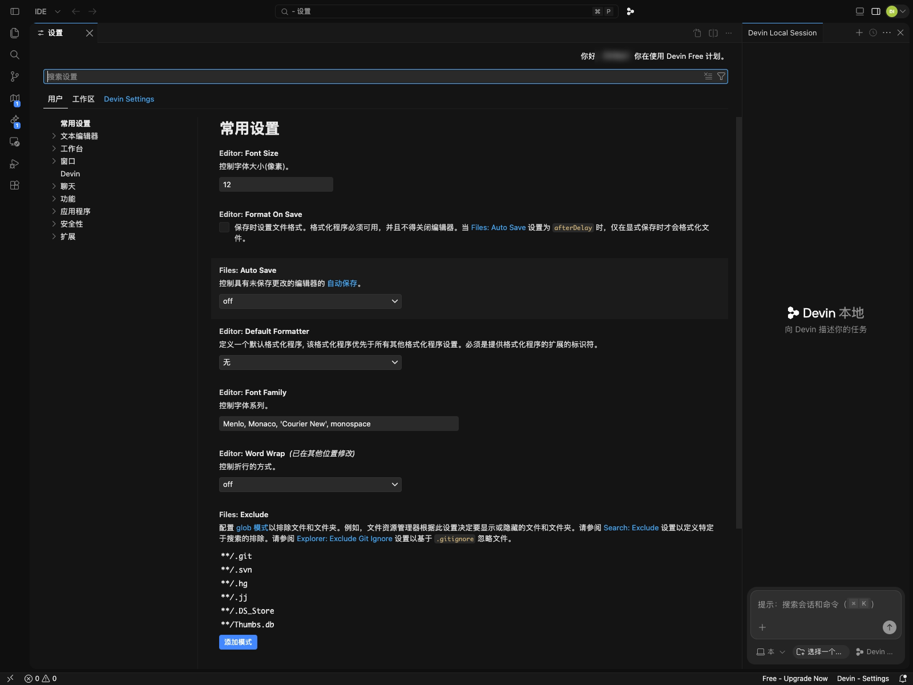

<p align="center">
  
</p>

<h1 align="center">devin-desktop-zh</h1>

<p align="center">
  Community Chinese localization for Devin Desktop — full coverage · 4 regional packs · one-click install<br>
  简体中文 (Mainland) · 繁體中文 (Taiwan) · 繁體中文 (Hong Kong) · 繁體中文 (Macau)
</p>

<p align="center">
  <a href="README.md">简体中文</a> ·
  <a href="README.zh-tw.md">繁體中文（台灣）</a> ·
  <a href="README.zh-hk.md">繁體中文（香港）</a> ·
  <a href="README.en.md">English</a>
</p>

<p align="center">
  
  
  
  
  
</p>

> Unofficial community localization, not affiliated with Cognition AI.

---

## Features

- **Full three-layer coverage**: menus/settings/editor (~28.8k strings), Agent panel & chat webview (35,368), builtin extensions (152)
- **Additive, not replacement**: Chinese is added as new display-language options — English and other languages are byte-for-byte untouched
- **Regional conventions**: zh-TW uses Taiwan terminology (使用者/預設/登入), zh-HK/zh-MO use Hong Kong conventions (用戶/資訊/檔案)
- **Integrity-check safe**: product.json checksums are refreshed after patching — no "installation appears corrupt" warning
- **Restorable & self-healing**: `restore` returns byte-identical originals; re-run install after OTA updates

## One-click install

```bash
git clone https://github.com/Till3005/devin-desktop-zh
cd devin-desktop-zh
bash install.sh          # macOS / Linux
powershell -ExecutionPolicy Bypass -File install.ps1   # Windows
```

After two restarts: Command Palette → `Configure Display Language` → pick a Chinese locale. Restore: `bash install.sh restore`

## Demo



The language picker lists four Chinese packs (zh-cn/zh-tw/zh-hk/zh-mo, alongside the official packs); menus, settings, command palette, the Devin pane and the greeting are fully localized. Raw capture: [demo.mp4](assets/screenshots/demo.mp4)

## Verified screenshots

| Settings (zh-CN) | Language picker (4 packs) |
|---|---|
|  |  |

| Login state (greeting + Devin pane) | Traditional Chinese (Taiwan) |
|---|---|
|  |  |

| File menu | Localized extension commands |
|---|---|
|  |  |

| English restored intact | Full VM screen (zh-CN) |
|---|---|
|  |  |

## How it works

| Layer | Mechanism | Coverage |
|---|---|---|
| nls | VS Code language packs into `~/.devin/extensions/` | Menus/settings/editor (MS baseline + 4,420 custom strings) |
| webview | zh dicts injected into i18next `resources`; `lng` reads `_VSCODE_NLS_LANGUAGE`; literals become conditional lookups | Agent panel/chat/onboarding |
| extensions | Inline strings converted to `%key%` + `package.nls.<loc>.json` | windsurf builtin extensions |

Every patched file has a `.devin-zh-backup` restore point.

## Translation quality

- zh-CN translated line-by-line with a unified glossary ([glossary.md](glossary.md)); Devin jargon stays English (Slack, MCP, ACU, PR, worktree, Cascade…)
- `{0}`, `{{var}}`, `\n`, `[text](url)`, `&&X` accelerators preserved exactly
- Traditional variants derived via OpenCC + regional term maps

## Honest boundaries

- Strings outside the corpus fall back to English (expected; file an issue to add them)
- Logged-in UI (Devin Settings page, in-session chat) not verified on a logged-in account
- Re-run the installer after app updates (idempotent)

## Repo layout

```
packs/<loc>/           4 finished language packs
translations/<loc>/    zh dictionaries per layer (webview/review/nls/exts/literals)
src/patch_app.py       additive patcher (apply/restore/status + checksum refresh)
src/merge_zh.py        corpus merge
src/build_packs.py     pack builder
src/gen_regions.py     traditional variants (OpenCC + regional maps)
install.sh / install.ps1
work/                  en corpora + sharded translation TSVs
```

## License

MIT. Microsoft vscode-loc baseline reused under MIT (vendor/ms-pack). This repo ships dictionaries and patches only — no app binaries.
