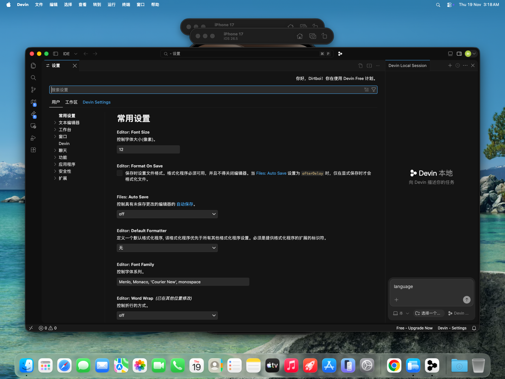
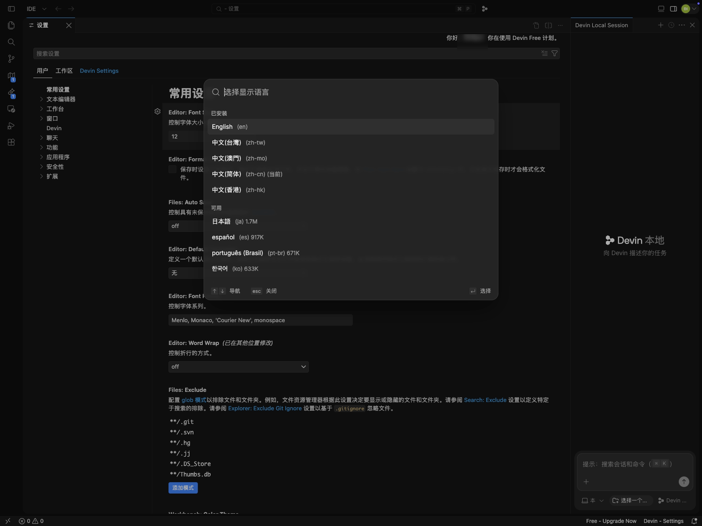
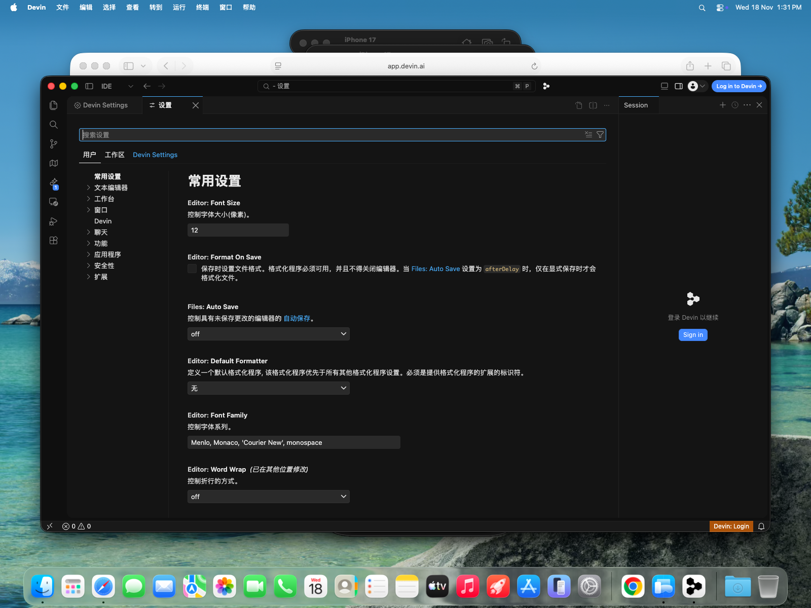
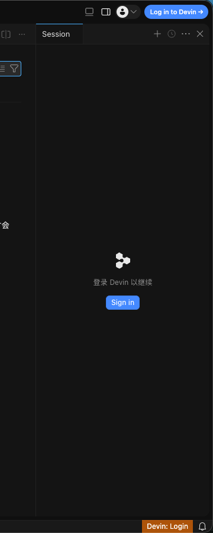
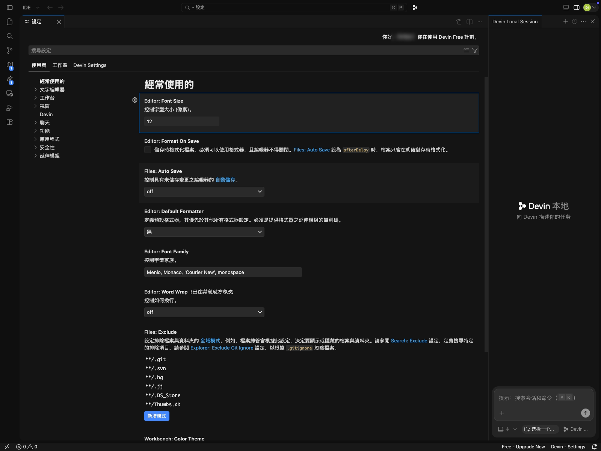
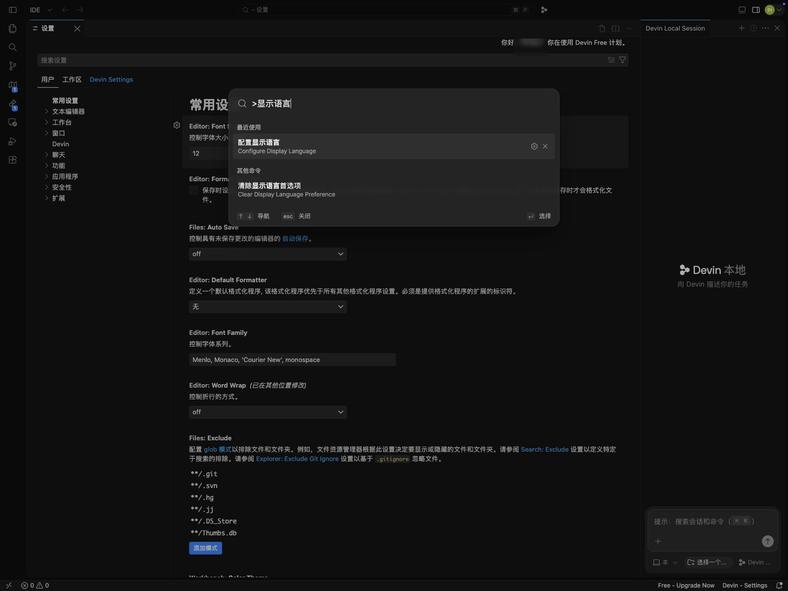
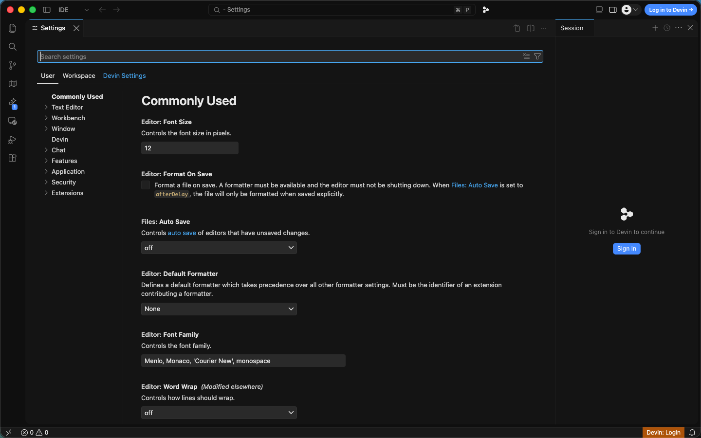

<p align="center">
  
</p>

<h1 align="center">devin-desktop-zh</h1>

<p align="center">
  Devin Desktop 的社区中文本地化——完整汉化 · 四地区语言包 · 一键安装<br>
  简体中文（大陆）· 繁體中文（台灣）· 繁體中文（香港）· 繁體中文（澳門）
</p>

<p align="center">
  <a href="README.md">简体中文</a> ·
  <a href="README.zh-tw.md">繁體中文（台灣）</a> ·
  <a href="README.zh-hk.md">繁體中文（香港）</a> ·
  <a href="README.en.md">English</a>
</p>

<p align="center">
  
  
  
  
  
</p>

> 非官方社区本地化项目，与 Cognition AI 无关。Unofficial community localization, not affiliated with Cognition AI.

---

## 特点

- **完整四层覆盖**：菜单栏/设置/编辑器（约 28,800 条）、Agent 面板与聊天 webview（35,368 条）、Devin 应用内嵌 webapp（登录态界面，26,509 条）、内置扩展（152 条）
- **新增式而非替换**：中文是新增的显示语言选项，English 和其它语言逐字节不受影响
- **各按各地习惯**：zh-TW 台湾惯用语（使用者/預設/登入），zh-HK/zh-MO 香港惯用语（用戶/資訊/檔案）
- **不破坏完整性校验**：自动回写 product.json checksums，不弹「安装似乎损坏」警告
- **可还原 · 可自愈**：`restore` 逐字节还原；OTA 升级后重跑安装即可

## 一键安装

```bash
git clone https://github.com/Till3005/devin-desktop-zh
cd devin-desktop-zh
bash install.sh          # macOS / Linux
powershell -ExecutionPolicy Bypass -File install.ps1   # Windows
```

重启两次后：命令面板搜 `Configure Display Language` → 选中文语言。还原：`bash install.sh restore`

## 实测截图

| 设置界面（zh-CN） | 语言选择器（4 中文包） |
|---|---|
|  |  |

| VM 全屏（zh-CN） |
|---|
|  |

| Agent 面板 webview | 繁體中文（台灣） |
|---|---|
|  |  |

| 扩展命令中文化 | English 切回无损 |
|---|---|
|  |  |

## 工作原理

| 层 | 机制 | 覆盖 |
|---|---|---|
| nls | VS Code 官方语言包装入 `~/.devin/extensions/` | 菜单/设置/编辑器（微软基线 + 4,420 条自翻） |
| webview | i18next `resources` 注入 zh 字典，`lng` 读 `_VSCODE_NLS_LANGUAGE`；字面量条件查询 | Agent 面板/聊天/onboarding |
| devin-webapp-host | 生成 zh 语言 chunk 并在应用内 i18next `gu[]` 语言表注册 zh-CN/zh-TW/zh-HK/zh-MO，`devin-language` 本地存储切换 | 登录态 Devin 设置/会话/评审界面 |
| 扩展 | 内联字符串转 `%key%` + `package.nls.<loc>.json` | windsurf 系列内置扩展 |

所有补丁有 `.devin-zh-backup` 还原点。

## 翻译质量

- zh-CN 逐条精翻 + 统一术语表（[glossary.md](glossary.md)）：你/命令/会话/工作区；Devin 专有名词保留英文（Slack、MCP、ACU、PR、worktree、Cascade…）
- `{0}`、`{{var}}`、`\n`、`[text](url)`、`&&X` 加速键原样保留
- 繁体由 OpenCC 转换 + 地区惯用语覆盖表派生

## 已知边界（诚实声明）

- 未收录语料的零散串回退英文（属预期，可提 issue 补录）
- 登录态界面（Devin Settings 页、会话内聊天）本机未登录验证，欢迎反馈
- OTA 升级后重跑一次安装脚本（幂等）

## 仓库结构

```
packs/<loc>/           4 个成品语言包
translations/<loc>/    各层中文字典（webview/review/nls/exts/literals/webapp）
src/patch_app.py       新增式补丁器（apply/restore/status + checksum 回写）
src/merge_zh.py        语料合并
src/build_packs.py     语言包构建
src/gen_regions.py     繁体派生（OpenCC + 地区词表）
install.sh / install.ps1
work/                  en 语料 + 分片翻译 TSV
```

## License

MIT。微软 vscode-loc 基线沿用 MIT 上游（vendor/ms-pack）。本仓库仅分发词典与补丁，不含 app 二进制。
