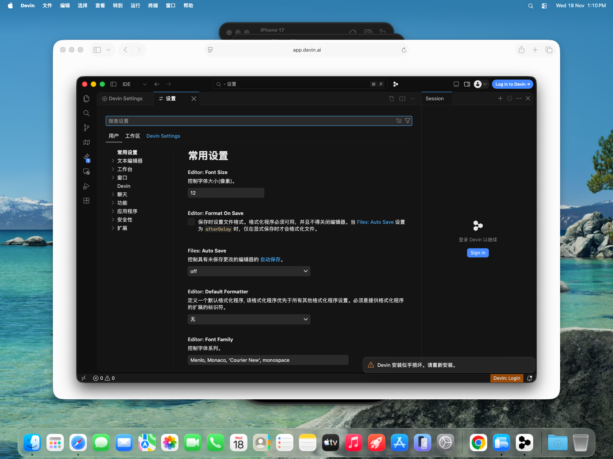
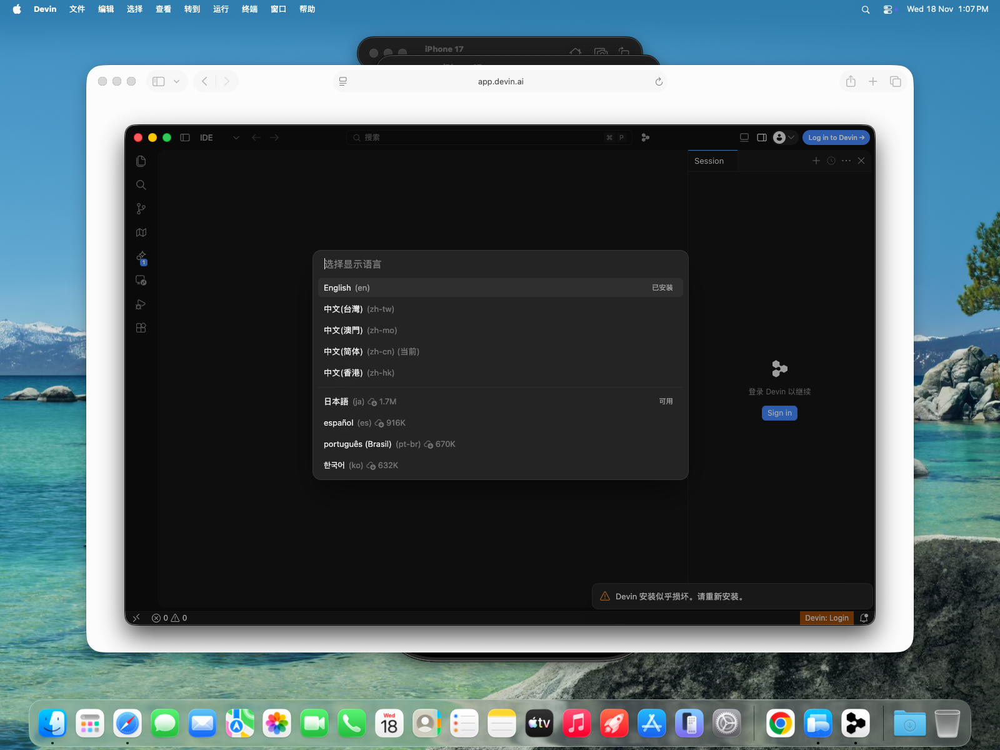
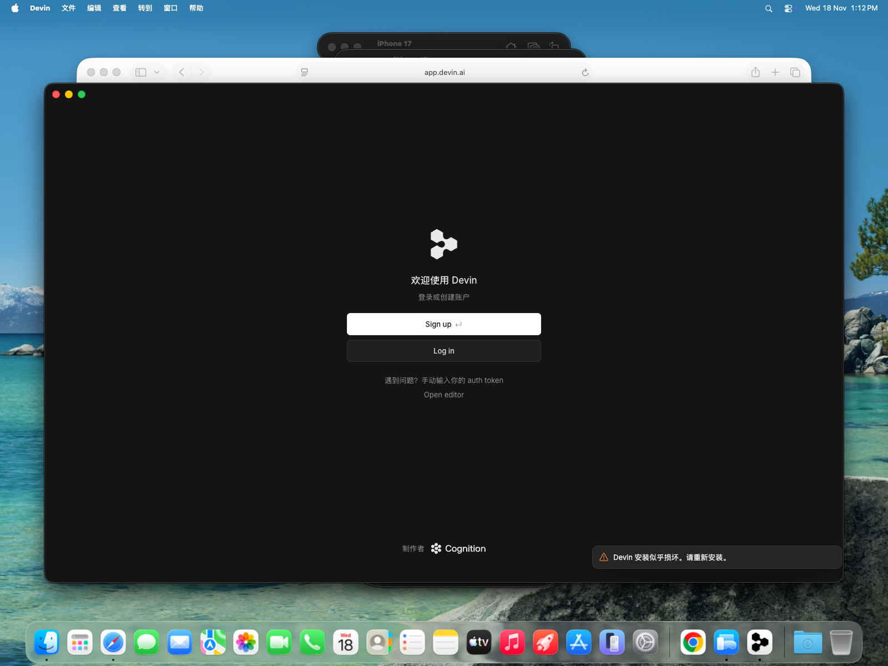
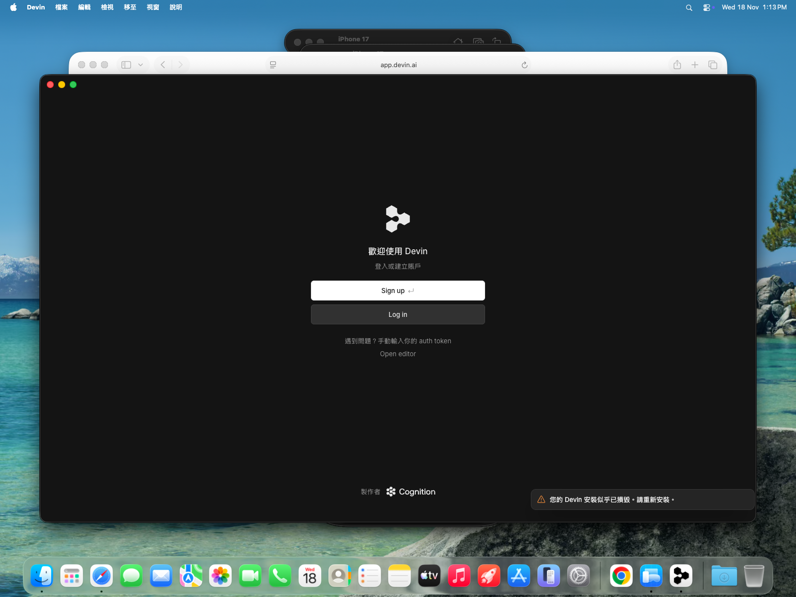
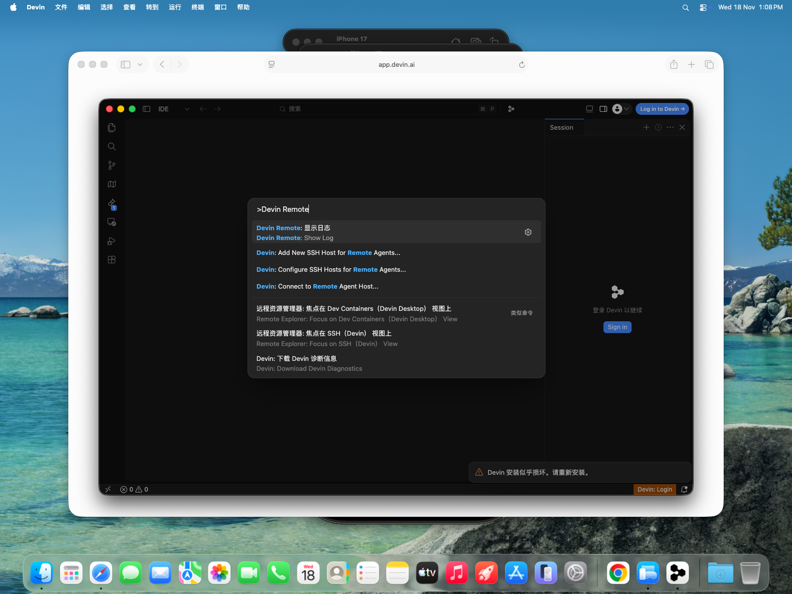
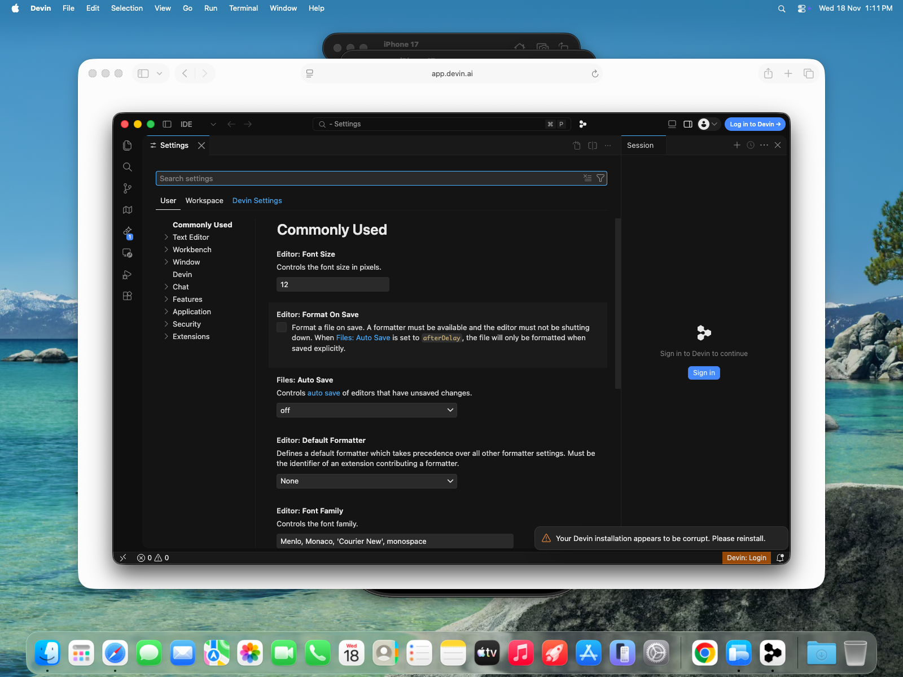

<p align="center">
  
</p>

<h1 align="center">devin-desktop-zh</h1>

<p align="center">
  Devin Desktop 的社區中文本地化——完整漢化 · 四地區語言包 · 一鍵安裝<br>
  簡體中文（大陸）· 繁體中文（台灣）· 繁體中文（香港）· 繁體中文（澳門）
</p>

<p align="center">
  <a href="README.md">簡體中文</a> ·
  <a href="README.zh-tw.md">繁體中文（台灣）</a> ·
  <a href="README.zh-hk.md">繁體中文（香港）</a> ·
  <a href="README.en.md">English</a>
</p>

<p align="center">
  
  
  
  
  
</p>

> 非官方社區本地化項目，與 Cognition AI 無關。Unofficial community localization, not affiliated with Cognition AI.

---

## 特點

- **完整三層覆蓋**：菜單欄/設置/編輯器（約 28,800 條）、Agent 面板與聊天 webview（35,368 條）、內置擴展（152 條）
- **新增式而非替換**：中文是新增的顯示語言選項，English 和其它語言逐字節不受影響
- **各按各地習慣**：zh-TW 台灣慣用語（使用者/預設/登入），zh-HK/zh-MO 香港慣用語（用户/資訊/檔案）
- **不破壞完整性校驗**：自動回寫 product.json checksums，不彈「安裝似乎損壞」警告
- **可還原 · 可自愈**：`restore` 逐字節還原；OTA 升級後重跑安裝即可

## 一鍵安裝

```bash
git clone https://github.com/Till3005/devin-desktop-zh
cd devin-desktop-zh
bash install.sh          # macOS / Linux
powershell -ExecutionPolicy Bypass -File install.ps1   # Windows
```

重啓兩次後：命令面板搜 `Configure Display Language` → 選中文語言。還原：`bash install.sh restore`

## 實測截圖

| 設置介面（zh-CN） | 語言選擇器（4 中文包） |
|---|---|
|  |  |

| Agent 面板 webview | 繁體中文（台灣） |
|---|---|
|  |  |

| 擴展命令中文化 | English 切回無損 |
|---|---|
|  |  |

## 工作原理

| 層 | 機制 | 覆蓋 |
|---|---|---|
| nls | VS Code 官方語言包裝入 `~/.devin/extensions/` | 菜單/設置/編輯器（微軟基線 + 4,420 條自翻） |
| webview | i18next `resources` 注入 zh 字典，`lng` 讀 `_VSCODE_NLS_LANGUAGE`；字面量條件查詢 | Agent 面板/聊天/onboarding |
| 擴展 | 內聯字符串轉 `%key%` + `package.nls.<loc>.json` | windsurf 系列內置擴展 |

所有補丁有 `.devin-zh-backup` 還原點。

## 翻譯質量

- zh-CN 逐條精翻 + 統一術語表（[glossary.md](glossary.md)）：你/命令/會話/工作區；Devin 專有名詞保留英文（Slack、MCP、ACU、PR、worktree、Cascade…）
- `{0}`、`{{var}}`、`\n`、`[text](url)`、`&&X` 加速鍵原樣保留
- 繁體由 OpenCC 轉換 + 地區慣用語覆蓋表派生

## 已知邊界（誠實聲明）

- 未收錄語料的零散串回退英文（屬預期，可提 issue 補錄）
- 登入態介面（Devin Settings 頁、會話內聊天）本機未登入驗證，歡迎反饋
- OTA 升級後重跑一次安裝腳本（冪等）

## 倉庫結構

```
packs/<loc>/           4 個成品語言包
translations/<loc>/    各層中文字典（webview/review/nls/exts/literals）
src/patch_app.py       新增式補丁器（apply/restore/status + checksum 回寫）
src/merge_zh.py        語料合併
src/build_packs.py     語言包構建
src/gen_regions.py     繁體派生（OpenCC + 地區詞表）
install.sh / install.ps1
work/                  en 語料 + 分片翻譯 TSV
```

## License

MIT。微軟 vscode-loc 基線沿用 MIT 上游（vendor/ms-pack）。本倉庫僅分發詞典與補丁，不含 app 二進制。
